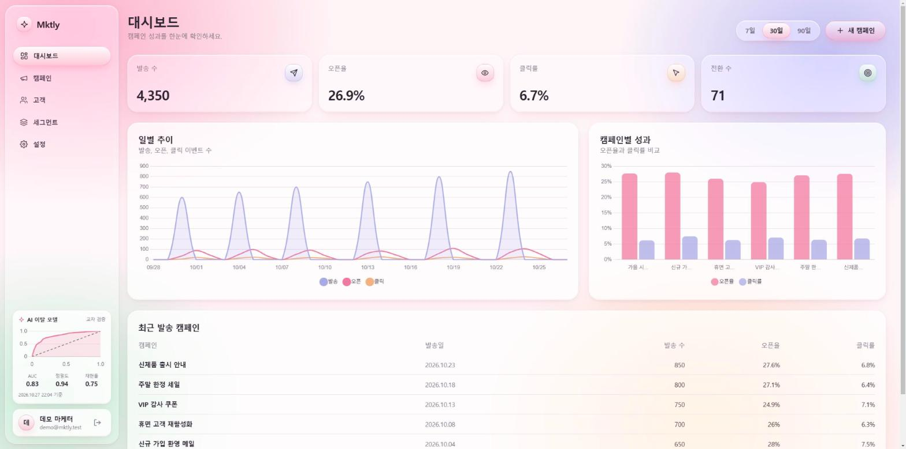
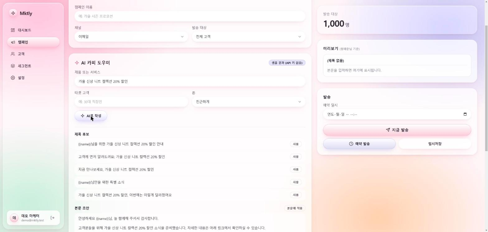
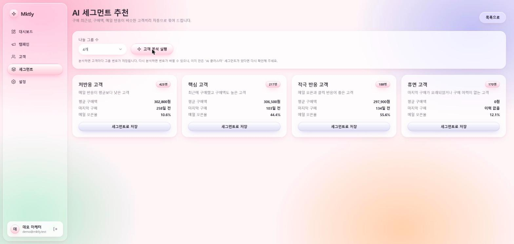
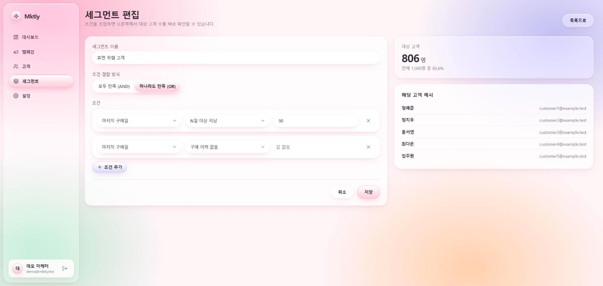
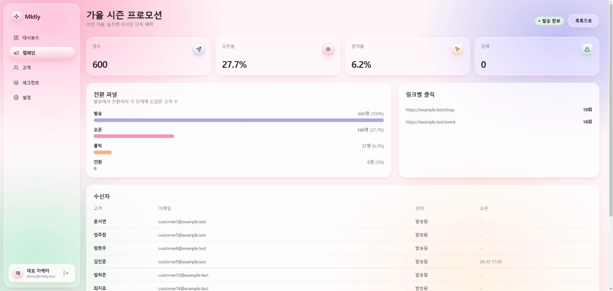
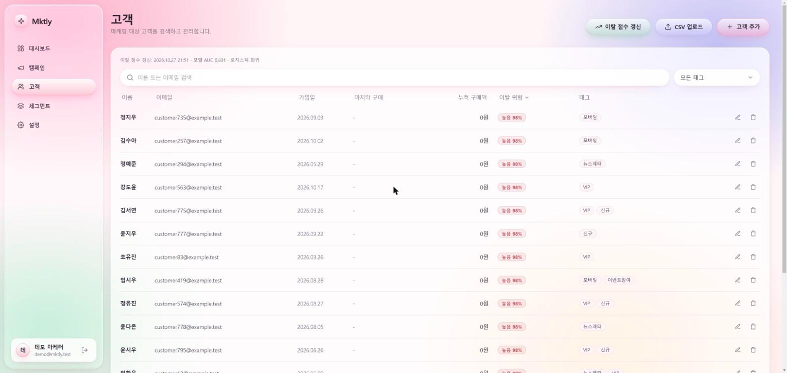
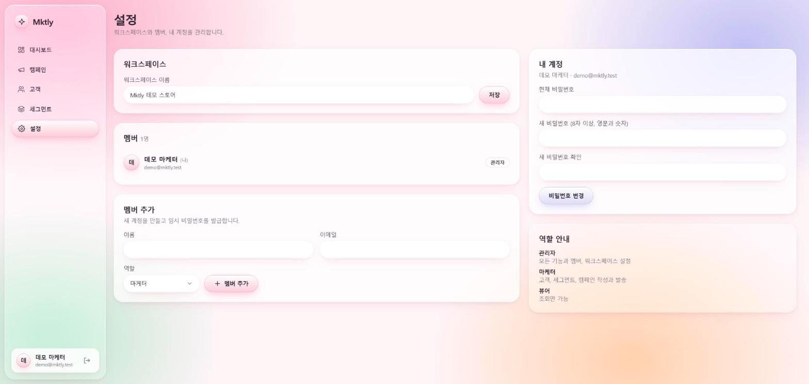

# Mktly

[](https://github.com/minhahamin/mktly/actions/workflows/ci.yml)

중소 비즈니스를 위한 **마케팅 자동화 + AI 인사이트 플랫폼**입니다. 고객 세그먼트를 만들고, 이메일 캠페인을 발송하고, 오픈과 클릭을 추적하고, AI로 카피를 쓰거나 이탈 위험 고객을 찾아냅니다.

PHP(Laravel)가 화면과 비즈니스 로직을, Python(FastAPI)이 AI 기능을 맡는 **멀티 서비스 구조**로 만들었고, 외부 유료 서비스 없이 Docker만으로 전체가 재현됩니다.



## 라이브 데모

**https://mktly-web-production.up.railway.app**

1. 로그인 화면의 **"데모 계정으로 시작하기"** 를 누르면 가입이나 비밀번호 없이 샘플 데이터(고객 1,000명, 캠페인 8개)를 **읽기 전용**으로 둘러볼 수 있습니다.
2. 직접 써 보고 싶다면 **회원가입**으로 나만의 워크스페이스를 만드세요. 고객 추가, CSV 업로드, 세그먼트, 캠페인 작성, AI 카피와 AI 세그먼트 추천까지 모두 쓸 수 있습니다.

| 둘러볼 곳 | 볼 수 있는 것 |
|---|---|
| 대시보드 | KPI, 일별 추이, 캠페인 비교, 사이드바의 AI 이탈 모델 성능(ROC 곡선) |
| 고객 | 검색, 정렬, 이탈 위험 등급, CSV 업로드 형식 |
| 세그먼트 | 조건 규칙과 대상 수 미리보기 |
| 캠페인 상세 | 전환 퍼널과 링크별 클릭 |

공개 서비스라서 안전장치를 두었습니다.

- 데모 계정은 읽기 전용이고 비밀번호를 바꿀 수 없습니다.
- 회원가입한 워크스페이스는 **체험 모드**로 시작합니다. 이메일은 실제로 발송되지 않습니다(스팸 남용 방지). SMS와 푸시는 모의 발송이라 체험할 수 있습니다.
- 같은 IP의 가입은 시간당 5번, AI 카피 생성은 사용자당 분당 10회와 하루 상한이 있습니다.
- 서버가 무료로 운영되는 개인 포트폴리오라 사용량이 많으면 응답이 느릴 수 있습니다.

## 주요 기능

| 영역 | 내용 |
|---|---|
| 대시보드 | 발송, 오픈율, 클릭률, 전환 KPI와 직전 기간 대비 증감, 일별 추이, 캠페인별 비교 (7/30/90일) |
| 고객 | 검색, 태그 필터, 정렬, CRUD, **CSV 업로드**(한글 열 이름, 엑셀 CP949 자동 변환, 중복/오류 행 리포트), 이탈 위험 등급 |
| 세그먼트 | AND/OR 조건 규칙, **입력 중 대상 수 실시간 미리보기**, 사람이 읽는 조건 요약 |
| 캠페인 | 작성, 변수 치환 미리보기, 즉시 발송, **예약 발송**, 500건 단위 큐 발송, 발송 진행률, 전환 퍼널과 링크별 클릭 |
| 추적 | 오픈 픽셀, 클릭 리디렉션, 수신자별 토큰 귀속 |
| AI | **카피 생성**(제목 후보 5개와 본문 초안), **이탈 확률 예측**(일 1회 배치), **고객 클러스터링**과 세그먼트 추천, 사이드바의 **모델 성능 카드**(ROC 곡선, AUC, 정밀도, 재현율) |
| 참고 자료(RAG) | 성과가 좋았던 과거 캠페인과 **브랜드 문서**(톤앤매너, 금칙어)를 임베딩으로 찾아 카피와 카드뉴스 초안에 반영하고, "참고한 자료"로 표시 |
| 카드뉴스 | 주제로 장별 문구 초안을 만들고 다듬은 뒤 PNG로 렌더(카드뉴스 3~6장 또는 대표 이미지 1장, 1:1/4:5/16:9). 글자는 서버가 한글 폰트로 그리고, 배경은 템플릿 또는 선택형 **AI 배경 삽화**. 개별 PNG와 ZIP 다운로드 |
| 설정 | 워크스페이스 이름, 멤버 추가/역할 변경/제거, 비밀번호 변경, 역할(관리자/마케터/뷰어) 권한 |

<table>
  <tr>
    <td><br><sub>AI 카피 도우미 (키가 없으면 샘플 결과)</sub></td>
    <td><br><sub>AI 세그먼트 추천 (K-means)</sub></td>
  </tr>
  <tr>
    <td><br><sub>세그먼트 편집과 실시간 대상 수</sub></td>
    <td><br><sub>캠페인 상세: 전환 퍼널과 링크별 클릭</sub></td>
  </tr>
  <tr>
    <td><br><sub>고객 목록과 이탈 위험 등급</sub></td>
    <td><br><sub>워크스페이스와 멤버 관리</sub></td>
  </tr>
</table>

## 아키텍처

```
[브라우저] --HTML / Livewire--> [Laravel app :8100] --> [MySQL 8]
                                  |   |   |
                                  |   |   +--> [Redis]  큐, 캐시, 세션
                                  |   +------> [Mailpit]  메일 수신(개발용 SMTP)
                                  +-- HTTP + 내부 토큰 --> [FastAPI ai :8101]
[queue 워커]  [scheduler]  ... 같은 Laravel 이미지, 발송과 예약, 이탈 점수 배치 담당
```

- 브라우저는 Laravel만 호출합니다. AI 서비스는 내부 토큰(`X-Internal-Token`)으로 보호되고 Laravel을 통해서만 접근합니다.
- 화면은 Blade + Livewire로 서버 렌더링하며 별도 프론트엔드 프로젝트나 화면용 JSON API가 없습니다.

## 기술 스택

| 영역 | 사용 기술 |
|---|---|
| 백엔드 | PHP 8.4, Laravel 13, Livewire 4, Alpine.js, Tailwind CSS v4, Chart.js, Vite |
| 데이터 | MySQL 8, Redis (큐, 캐시, 세션) |
| AI 서비스 | Python 3.12, FastAPI, scikit-learn, pandas, httpx (Gemini, OpenAI REST) |
| 인프라 | Docker Compose (app, queue, scheduler, ai, mysql, redis, mailpit) |
| 테스트 | Pest 250개 (Livewire 포함), pytest 45개 |

## 실행 방법

필요한 것: Docker Desktop, Node.js 22 이상(프론트 에셋 빌드용). PHP와 Python은 설치할 필요가 없습니다.

```bash
git clone https://github.com/minhahamin/mktly.git && cd mktly

# 1. 환경 파일
cp backend/.env.example backend/.env

# 2. PHP 의존성 설치 (vendor는 Docker 볼륨에 보관해 Windows에서도 빠르게 동작합니다)
docker compose run --rm -w /var/www/html app composer install

# 3. 앱 키 생성, 전체 기동, DB 준비(데모 데이터 포함)
docker compose run --rm -w /var/www/html app php artisan key:generate
docker compose up -d --build
docker compose exec -w /var/www/html app php artisan migrate --seed

# 4. 프론트 에셋 빌드
cd backend && npm install && npm run build
```

| 주소 | 용도 |
|---|---|
| http://localhost:8100 | 앱 (로그인 화면의 "데모 계정" 입력하기 버튼으로 바로 로그인할 수 있습니다) |
| http://localhost:8125 | Mailpit: 발송한 메일을 확인합니다 |
| http://localhost:8101/docs | AI 서비스 API 문서 (내부 토큰이 필요한 엔드포인트가 있습니다) |

호스트 포트는 다른 프로젝트와 겹치지 않도록 일부러 비표준 값을 썼고, 루트 `.env`로 바꿀 수 있습니다(`.env.example` 참고).

로컬에서는 `migrate --seed`가 데모 워크스페이스와 샘플 데이터를 자동으로 만듭니다. 데모 계정의 비밀번호가 저장소에 공개되어 있으므로 **로컬 환경(`APP_ENV=local`)에서만** 자동 시드되고, 다른 환경에서는 건너뜁니다.

### AI 카피를 실제 모델로 쓰려면

루트에 `.env`를 만들고 키를 넣은 뒤 `docker compose up -d`를 다시 실행하세요. Gemini(무료)를 먼저 호출하고, 한도 초과나 서버 오류가 나면 OpenAI(유료)로 넘어갑니다. 키가 모두 없으면 AI 서비스는 샘플 결과를 돌려주는 Mock 모드로 동작하고, 화면에 "샘플 결과" 표시가 나타납니다.

```
GEMINI_API_KEY=여기에_키
OPENAI_API_KEY=여기에_키   # 선택
```

카드뉴스 AI 배경 삽화는 유료라(Gemini 이미지 생성에는 무료 등급이 없습니다) 기본으로 꺼져 있습니다. 쓰려면 결제가 연결된 Gemini 키를 넣고 `backend/.env`에 `MKTLY_AI_IMAGE_DAILY_LIMIT=5`처럼 하루 상한을 정하세요. 만들기 화면에 "AI 배경 삽화 사용" 선택지가 나타나고, 호출이 실패하면 템플릿 배경으로 그립니다.

### 테스트

```bash
docker compose exec -w /var/www/html app ./vendor/bin/pest     # Laravel
docker compose exec ai python -m pytest                          # AI 서비스
docker compose exec -w /var/www/html app ./vendor/bin/pint       # 코드 스타일
```

테스트는 sqlite 메모리 DB에서만 실행되며, 개발용 MySQL에서 실행되려 하면 시작 전에 중단됩니다.

## 배포 (Railway)

웹, 큐 워커, 스케줄러를 한 컨테이너로 묶고 큐, 세션, 캐시를 MySQL에 저장해서 **서비스 3개(웹, AI, MySQL)** 로 줄였습니다. 첫 관리자는 환경변수로 만들고, 공개 데모 데이터는 별도 워크스페이스에 읽기 전용 계정으로 만듭니다. 자세한 절차는 [DEPLOY.md](DEPLOY.md)를 보세요.

## 설계에서 신경 쓴 부분

- **워크스페이스 격리**: 모든 소유 모델에 글로벌 스코프를 적용하고, 정책(Policy)으로 역할을 검사하며, Livewire 액션 안에서도 다시 인가합니다. 다른 워크스페이스의 id를 직접 넣어도 404가 됩니다(테스트 포함).
- **발송 파이프라인**: 수신자 메시지를 먼저 만들고 500건 단위 잡으로 나눠 보냅니다. 상태를 원자적으로 선점해서 예약 실행기와 수동 발송이 겹쳐도 한 번만 시작되고, 일부가 실패해도 나머지는 계속 보냅니다.
- **추적 보안**: 오픈/클릭 토큰은 40자 랜덤 값이고, 리디렉션 대상은 발송 시점에 저장한 URL로 고정되어 파라미터로 바꿀 수 없습니다(오픈 리디렉션 방지). 알 수 없는 오픈 토큰도 같은 응답을 줘서 유효한 토큰을 추측할 수 없습니다.
- **세그먼트 엔진의 SQL 안전성**: 조건의 항목과 연산자는 화이트리스트에서만 고르고 값은 항목별로 검증합니다. 주입 시도는 테스트로 막혀 있습니다.
- **본문 렌더링**: 본문을 먼저 이스케이프한 뒤 변수를 이스케이프된 값으로 치환하므로 고객 이름에 들어간 HTML이 실행되지 않습니다.
- **AI 호출 보호**: 사용자당 호출 횟수를 제한하고, AI 서비스에는 이메일과 이름 같은 개인 식별 정보를 보내지 않으며(행동 지표만 전송), 장애 시 내부 오류 문구 대신 사용자용 안내를 보여줍니다. LLM 응답에서는 이모지를 제거하고, 사용자 입력은 태그로 격리해 프롬프트 주입을 완화합니다.
- **리퀴드 글래스 디자인**: 반투명 유리 표면(`backdrop-filter`), 파스텔 핑크 팔레트, 공용 Blade 컴포넌트로 구성했고 `backdrop-filter` 미지원과 `prefers-reduced-transparency`를 위한 대체 스타일을 뒀습니다.

## 한계와 알아둘 점

솔직하게 적어 둡니다.

- **이탈 모델은 데모용입니다.** 실제 이탈 기록이 없어서 "90일 이상 구매 없음"을 대리 라벨로 학습합니다. 구매 최근성은 라벨 정의에 쓰이므로 입력에서 제외했고(라벨 누수 방지), 구매액, 가입 기간, 메일 반응으로 위험도를 계산합니다. 화면에 모델 방식과 AUC를 함께 표시합니다. 실서비스에서는 실제 이탈 데이터로 교체해야 합니다.
- **카드뉴스 AI 배경 삽화는 유료 기능**입니다. 상한을 정하지 않으면 꺼져 있습니다. 실제 Gemini 이미지 모델로 만든 결과는 직접 확인하지 않았고, 응답 처리와 실패 시 대체는 테스트로만 검증했습니다.
- **SMS와 푸시는 모의 채널**입니다. 실제 전송 없이 발송 완료로만 기록합니다.
- **전환(conversion) 이벤트를 기록하는 경로가 아직 없습니다.** 데모 시드 데이터에만 있고, 새로 발송한 캠페인의 전환 수는 0으로 표시됩니다. 쇼핑몰 연동이나 웹훅이 필요한 부분입니다.
- 클러스터링을 다시 실행하면 그룹 번호가 바뀔 수 있습니다. 이미 "AI 클러스터" 세그먼트를 만들어 두었다면 화면의 안내대로 다시 확인해야 합니다.
- 깨끗한 환경에서 위 실행 방법을 처음부터 끝까지 다시 실행해 검증하지는 않았습니다. 개발 중인 환경에서 같은 명령들을 개별로 확인했습니다.

## 프로젝트 구조

```
Mktly/
  backend/               Laravel 앱 (화면, 비즈니스 로직)   -> backend/CLAUDE.md
    app/Livewire/        페이지 컴포넌트 (Auth, Dashboard, Contacts, Segments, Campaigns, Settings)
    app/Services/        Segments, Campaigns, Contacts, Ai, Dashboard
    app/Jobs, Console/   발송 잡, 예약 발송과 이탈 점수 명령
    resources/views/components/glass/   리퀴드 글래스 UI 컴포넌트
  ai/                    FastAPI 서비스 (카피, 이탈 예측, 클러스터링)   -> ai/CLAUDE.md
  docs/screenshots/      README 이미지
  docker-compose.yml
  SPEC.md                요구사항과 설계 문서
```

요구사항과 설계 결정은 [SPEC.md](SPEC.md)에 정리되어 있습니다.
