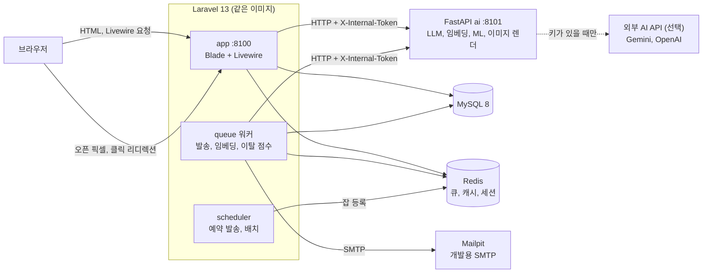
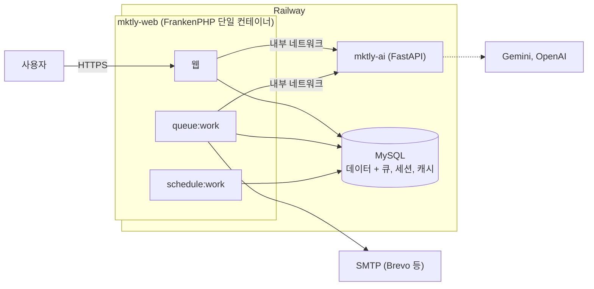
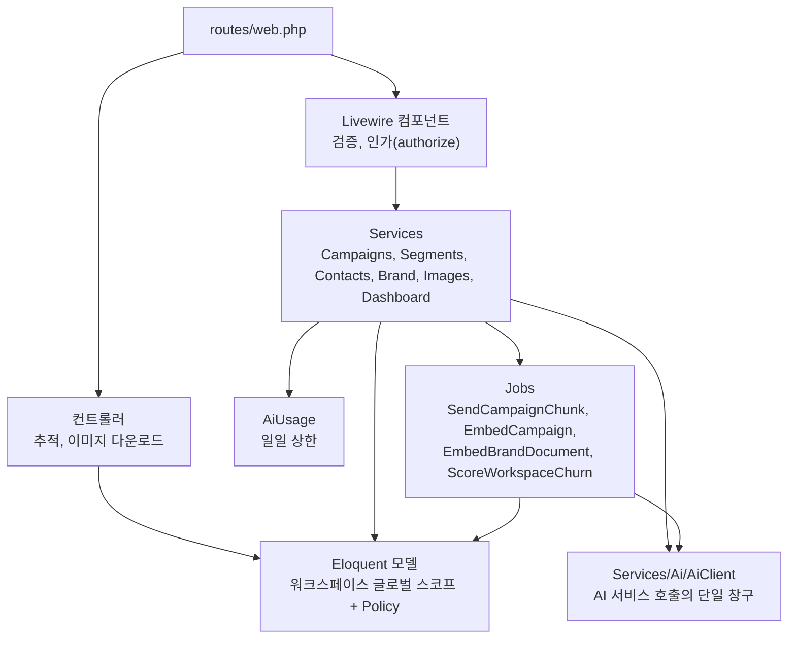
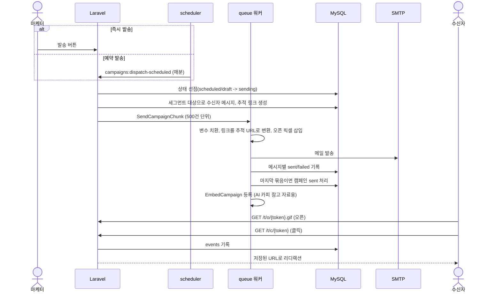
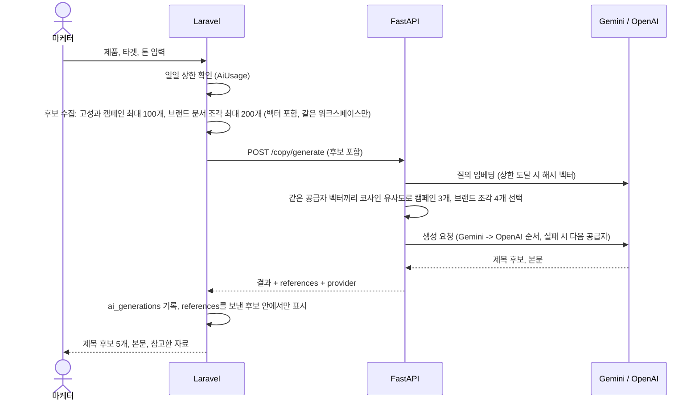
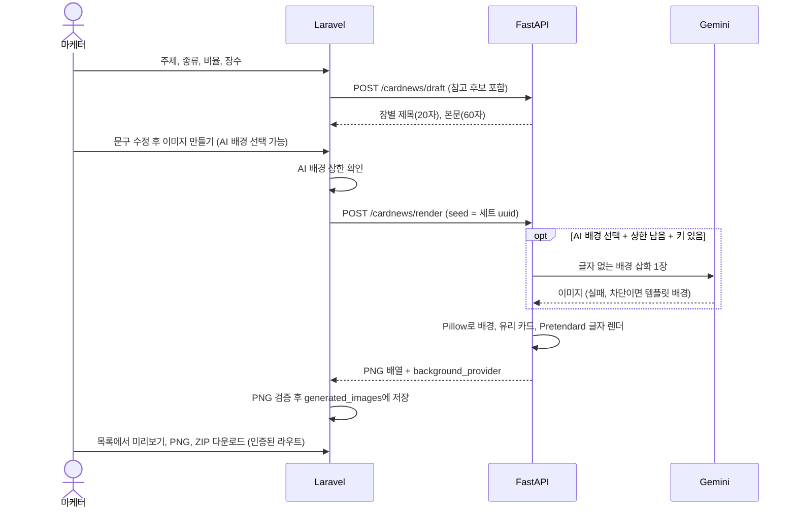
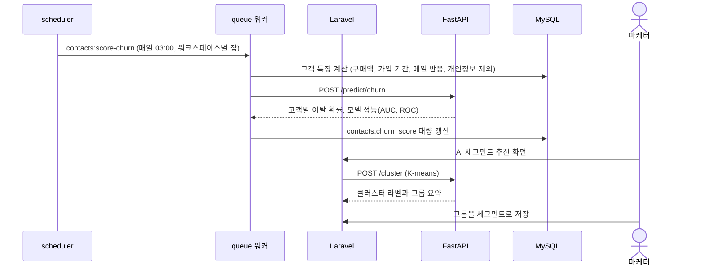

# Mktly 아키텍처

요구사항은 [SPEC.md](../SPEC.md)가 기준입니다. 이 문서는 구성 요소가 어떻게 연결되고 주요 기능이 어떤 순서로 동작하는지를 그림으로 정리합니다.

## 1. 시스템 구성 (로컬, Docker Compose)

- 브라우저는 Laravel만 호출합니다. AI 서비스는 외부에 열지 않고, Laravel이 내부 토큰을 붙여 중계합니다.
- AI 서비스는 DB에 접근하지 않습니다. 필요한 데이터(고객 특징, 참고 후보 벡터)는 Laravel이 요청에 담아 보냅니다.
- 키가 없으면 AI 서비스는 Mock 결과, 해시 벡터, 템플릿 배경으로 동작해서 외부 호출 없이 전체 기능이 돌아갑니다.

## 2. 배포 구성 (Railway)

- 웹, 큐 워커, 스케줄러를 한 컨테이너에 묶고 큐, 세션, 캐시를 MySQL에 두어 서비스를 3개(웹, AI, MySQL)로 줄였습니다.
- 자세한 절차는 [DEPLOY.md](../DEPLOY.md)를 보세요.

## 3. Laravel 내부 계층

- 화면용 JSON API가 없습니다. 목록, 폼, 대시보드 상호작용은 Livewire 액션으로 처리합니다.
- 워크스페이스 소유 모델은 글로벌 스코프로 걸러지고, 역할(admin, marketer, viewer)은 Policy로 검사합니다.

## 4. 주요 흐름

### 4.1 캠페인 발송과 추적

### 4.2 AI 카피 생성 (참고 자료 RAG 포함)

키가 없으면 FastAPI가 고정 샘플(Mock)을 돌려주고 화면에 "샘플 결과"가 표시됩니다.

### 4.3 카드뉴스 / 대표 이미지

### 4.4 이탈 예측과 세그먼트 추천

### 4.5 백그라운드 작업 정리

| 작업 | 실행 시점 | 하는 일 |
|---|---|---|
| `campaigns:dispatch-scheduled` | 매분 | 예약 시각이 지난 캠페인 발송 시작 |
| `SendCampaignChunk` | 발송 시작 시 | 500건 단위 메일 발송, 끝나면 캠페인 마감 |
| `EmbedCampaign` | 캠페인 발송 완료 시 | 제목, 본문 임베딩 저장 (수신자 30명 이상) |
| `EmbedBrandDocument` | 브랜드 문서 등록 시 | 조각별 임베딩 저장 |
| `mktly:embeddings:rebuild` | 매시간 | 빠진 임베딩 채우기 |
| `contacts:score-churn` | 매일 03:00 | 워크스페이스별 이탈 점수 갱신 |
